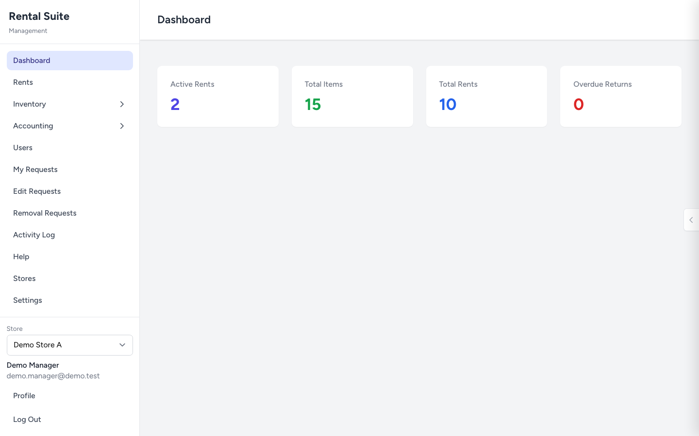
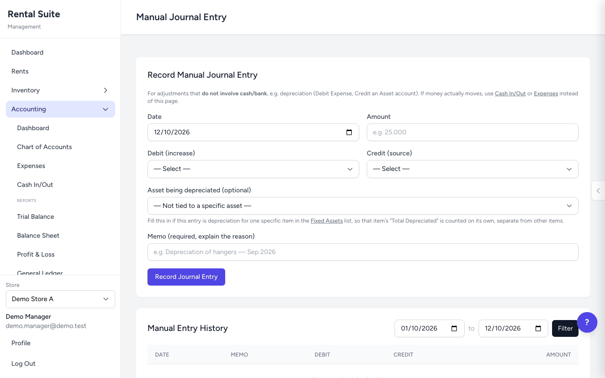

# Rental Suite

A multi-store rental operations app and ERP-style back office (inventory, stock count, double-entry accounting, reports) built with Laravel 13 / PHP 8.3. It handles the full life of a rental (booking, payment, pick-up, return) and keeps a double-entry ledger in sync with every money movement. This repository is a generic, anonymised demo: all names, prices and figures are fictional.

## What it shows

- **Rentals priced in blocks** (3-day blocks), tax-inclusive prices (the VAT portion for bills and the VAT estimate report is derived as price ÷ 1.1; revenue is booked at the tax-inclusive amount), down payments and full payments, late-return fines.
- **Approval workflow** for risky changes (edit a paid rental, remove an item, swap an item, mark as free, delete a wrong entry). Roles: `admin`, `supervisor`, `management`, `super_admin`, `accounting`. Self-approval is blocked for edit, item-removal, free, late-done and wrong-input-delete requests (see `docs/approval-workflow.md` for the one known gap).
- **Shifts**: cash is attributed to the open shift of the cashier; closing a shift produces a report and PDF.
- **Double-entry ledger**: every payment, refund and cancellation is posted as a balanced journal entry (`RentalPaymentRecorder` → `JournalPostingService`); `RentalLedgerSync` reconciles rentals against the ledger.
- **Accounting module**: chart of accounts, journals, expenses, fixed assets with depreciation, balance sheet, income statement, trial balance, receivables.
- **Multi-store** scoping (`BelongsToStore`, `SetCurrentStore` middleware).
- **Practice mode**: guided tours run on separate `tutorial_*` tables so practice data never mixes with real data (covered by leakage tests).
- **Stock count**, item QR codes, invoice/receipt images and WhatsApp-style message sending (simulated locally).

## Screenshots

Fictional demo data (see `DemoPortfolioSeeder`).

| | |
|---|---|
|  |  |
|  |  |
|  |  |

## Docs

- [Feature catalogue](docs/features.md)
- [Case study](docs/case-study.md)
- [Architecture](docs/architecture.md)
- [Approval workflow](docs/approval-workflow.md)
- [Accounting ledger](docs/accounting-ledger.md)

## Architecture notes

Money logic lives in `app/Support/`:

| Class | Role |
|---|---|
| `RentalFinancialSummary` | single source of bill math (invoices, reports, reminders) |
| `RentalPaymentRecorder` | records a payment and posts its journal |
| `RentalLedgerSync` | keeps rental state and ledger consistent |
| `RentalFreeRequest`, `RentalLateDone` | approval-driven special cases |
| `RentalAnomalyDetector` | flags suspicious rental histories |

Front end: Blade + Alpine + prebuilt Tailwind (no build step needed to run).

## Run locally

```bash
composer install
cp .env.example .env && php artisan key:generate
touch database/database.sqlite
php artisan migrate
php artisan serve
```

Create the base users with `php artisan db:seed` (see `database/seeders/DatabaseSeeder.php`; local demo credentials only) or load the fictional demo dataset into a separate demo database (the seeder refuses to run unless the database name contains `demo`):

```bash
touch database/demo.sqlite
DB_DATABASE=database/demo.sqlite php artisan migrate
DB_DATABASE=database/demo.sqlite php artisan db:seed --class=DemoPortfolioSeeder
```

Then set `DB_DATABASE=database/demo.sqlite` in `.env` and log in as `demo.manager@demo.test` (password in the seeder).

## Tests

```bash
php -d memory_limit=1G vendor/bin/phpunit
```

About 600 tests run on in-memory SQLite: rental lifecycle, payments, approvals, shifts, ledger balance, role access, and practice-data isolation.
