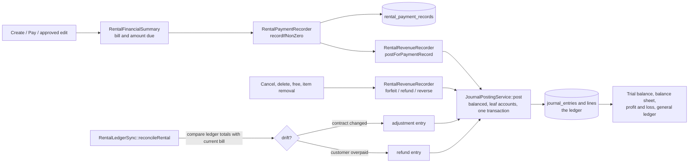

# Architecture

## Overview

Rental Suite is a server-rendered Laravel 13 / PHP 8.3 application (Blade + Alpine + prebuilt Tailwind, no build step needed to run). It covers the whole life of a rental and keeps a balanced double-entry ledger in step with every money movement.

- **Controllers** (`app/Http/Controllers`) validate input, check roles and orchestrate. The rentals page also talks JSON to `public/js/rentals-index.js`.
- **Money logic** lives in static classes under `app/Support`, so that every flow shares one code path.
- **Eloquent models** carry the scoping traits (`BelongsToStore`, `ExcludesTutorialData`, `ExcludesAccountingTrialData`) that implement multi-store and practice-data isolation.

## Module map

| Area | Main classes |
|---|---|
| Rentals | `RentalController`, `Rental`, `RentalPaymentRecord`, `RentalActivityLog` (history of every step) |
| Pricing | `RentalFinancialSummary` (the single source of bill math for invoices, reports, reminders, approvals) |
| Approvals | `RentalApprovalController`, `RentalApprovalRequest`, `RentalFreeRequest`, `RentalLateDone`, `PaymentShiftAssignment` (see `approval-workflow.md`) |
| Shifts | `ShiftController`, `ShiftSession`, `ShiftClosedTotals` (cash is attributed to the cashier's open shift) |
| Ledger | `RentalPaymentRecorder`, `RentalRevenueRecorder`, `JournalPostingService`, `RentalLedgerSync`, `Account`, `JournalEntry`, `JournalEntryLine` |
| Accounting module | `AccountController`, `ExpenseRecorder`, `CashMovementRecorder`, `ManualJournalEntryController`, `FixedAssetRecorder`, `AccountingReportController` (see `accounting-ledger.md`) |
| Catalog and stock | `OutfitController`, `Outfit`, `StockOpnameController` |
| Documents | `InvoiceController`, `InvoiceNumberGenerator` (receipt image/PDF, message sending) |
| Tenancy and users | `StoreController`, `UserController`, `SetCurrentStore`, `RoleMiddleware`, `StoreContext`, `StoreCache` |
| Oversight | `ManagerReportController`, `RentalAnomalyDetector`, activity log pages |

## Request flow: create, pay, pick up, return

All routes sit behind `auth` and `set.store` (`routes/web.php`).

| Step | Route | Handler | Guards | Writes |
|---|---|---|---|---|
| Create | `POST /rentals` | `RentalController::store` | role may operate rentals; admin needs an open shift; discount notes required; extra charge required when the dates are not a multiple of 3 days; full payment must reach the bill, any payment must not exceed it; item date conflicts (non-managers whose only clash is the return cool-down file a `create` approval instead) | `rentals` row, `rental_outfit` rows with locked prices, history entry, then the payment (capped at the bill) |
| Pay | `PUT /rentals/{rental}` | `RentalController::update` | a save that only raises `amount_paid` is applied directly, even for admin; any other admin edit becomes an `edit` approval | payment record for the difference, ledger reconcile |
| Pick up | `POST /rentals/{rental}/pickup` | `updatePickup` | rental active; no edit request pending; nothing left to pay | `picked_up_at`, history entry |
| Return | `POST /rentals/{rental}/status` | `updateStatus` | must be picked up and fully paid; no edit request pending; returned and cancelled are end states that only management reopens (a return can be undone by its author within 30 minutes) | status, history entry |

Every payment, from any of these routes or from an approved request, ends in the same place:

`RentalPaymentRecorder::recordIfNonZero` writes a `rental_payment_records` row, then calls `RentalRevenueRecorder::postForPaymentRecord`, which builds the lines and hands them to `JournalPostingService::post`. A posting failure is logged, not thrown: the payment still succeeds and `journal_entry_id` stays null until `RentalLedgerSync` repairs it.

## Money flow

## Multi-store scoping

- Tables: `stores` and the `store_user` pivot. Models using `BelongsToStore` get `store_id` filled on create from `StoreContext` (first store as fallback) and a global scope `store_scope` filtering every query.
- `SetCurrentStore` (middleware alias `set.store`) decides the store per request. Management, super admin and accounting see every active store; other roles only their assigned stores. The choice is kept in the session (`POST /stores/switch`) and re-validated on each request. Privileged roles can add `all_stores=1` to drop the filter.
- Per-store settings (tax percent, prices include tax, cash and bank account mapping, buffer days) are read by `StoreCache` with a global fallback.
- Deciding a request of a store the user cannot access is refused (`refuseOtherStoreDecision`). The `{rental}` binding looks across the user's accessible stores; `{approval}` does the same for management and super admin, other roles resolve within the current store.
- The Chart of Accounts is shared by all stores. Journal entries carry a `store_id`, and reports take one store or all.

## Practice (tutorial) data isolation

Guided tours must never touch real data. Three layers:

1. **Separate tables** for rentals, items, approvals, history and shifts: `tutorial_rentals`, `tutorial_rental_outfit`, `tutorial_rental_approval_requests`, `tutorial_rental_activity_logs`, `tutorial_shift_sessions`. `TutorialRental` extends `Rental` with its own table and id sequence. Practice routes carry `?tutorial=1` (or the hidden `tutorial_practice` field), and the bindings only return practice rows created by the same user. Practice shifts use a dedicated `{tutorialShift}` binding because ids collide with real shifts.
2. **No ledger for practice rentals**: `RentalPaymentRecorder` returns early for a `TutorialRental`, and `RentalLedgerSync::reconcileRental` skips them.
3. **Flags on shared tables**: rows with `is_tutorial` (outfits, rentals, requests, logs) are hidden by `ExcludesTutorialData`. Accounting rows carry `is_tutorial_practice` (always excluded) and `is_tutorial` (set while Accounting Trial Mode is on, excluded once it is off), applied by `ExcludesAccountingTrialData` and repeated by hand in raw joins.

Covered by `PracticeLeakageTest`, `PracticeAccountingLeakageTest`, `PracticeSaveIsolationTest` and `TutorialIdCollisionTest`.

## Tax-inclusive pricing and 3-day blocks

Store settings: `pricing_tax_percent`, `pricing_prices_include_tax`, `pricing_enabled`. With prices tax-inclusive and 10% tax, `excl = price / 1.1` and `tax = price - excl`. The code unwraps with `rate / (1 + rate)`, never `rate` applied to the inclusive price. Example: 110 included gives 100 excluded plus 10 tax.

- **Locked prices**: each `rental_outfit` row stores `price_incl_tax`, `price_excl_tax` and `tax_amount` at booking time. A catalog price change does not re-price an existing rental; only a newly added item is priced from the catalog.
- **Blocks** (`RentalFinancialSummary::billingInfo`): calendar days = end - start + 1; billed days = `max(3, floor(days / 3) * 3)`; blocks = billed days / 3. The unit price is charged once per block. Left-over days are "extra days" and need a manual extra charge on create. Rentals created before `pricing_legacy_cut_off_date` keep the older day formula.
- **Order of math**: line price x blocks, item discounts, order discount (fixed or percent), tax (derived from the inclusive total, or added when prices are exclusive), then `extra_charge` and the overdue fee are added to `net_incl_tax`.
