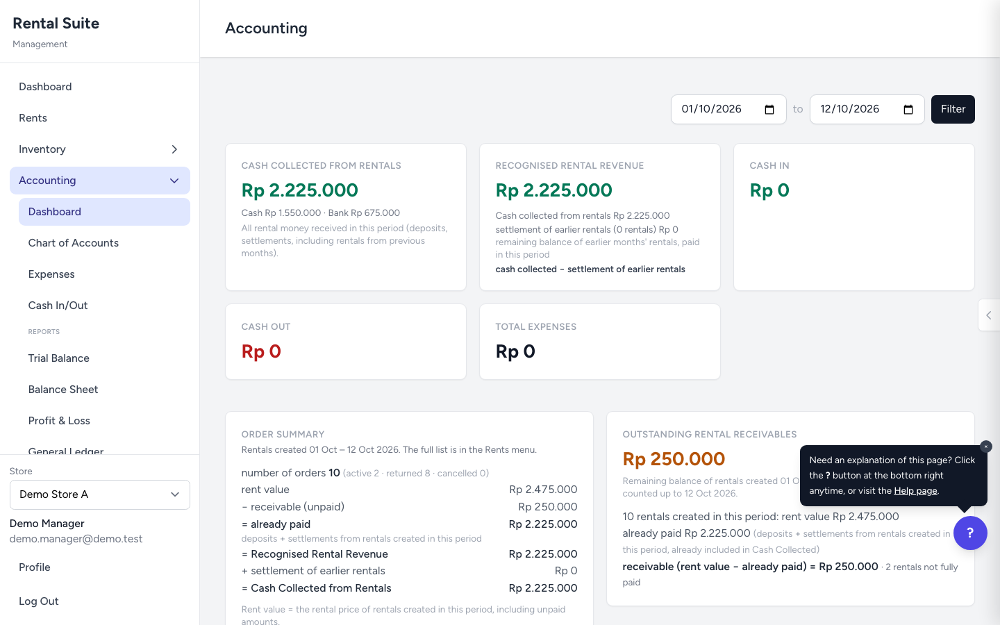

# Case study: Rental Suite

A multi-store rental and accounting system, built with Laravel 13 / PHP 8.3. This page is the short version for a reader who wants to know what the project is, which problems were hard, and how I checked that the money logic is right. All data in the repository and screenshots is fictional.

## The problem

A small rental business with more than one store tracked rentals, deposits and cash on paper and in spreadsheets. The pain points were concrete:

- Cash received on a rental never matched the books at the end of the day.
- Staff could change or delete a paid rental with no trace and no second pair of eyes.
- A cashier's takings were hard to attribute to a shift, so closing a shift was a manual count.
- The accountant needed a proper ledger and reports, not a spreadsheet of totals.

## What I built

| Area | What it does |
|---|---|
| Rentals | Booking, deposits and full payments, pick-up, return, late fees, 3-day pricing blocks, tax-inclusive prices |
| Approvals | Risky changes (edit a paid rental, remove an item, mark as free, delete a wrong entry, backdated pick-up) go through a request that a different, authorised person must approve |
| Shifts | Every payment is attributed to the cashier's open shift; closing a shift produces a report and a PDF |
| Ledger | Every payment, refund and cancellation posts a balanced double-entry journal; a reconciler checks rentals against the ledger |
| Accounting | Chart of accounts, manual journals, expenses, fixed assets with depreciation, trial balance, balance sheet, profit and loss, general ledger, receivables |
| Multi-store | Each store sees only its own rentals, items, shifts and ledger |
| Practice mode | Guided tours run on separate `tutorial_*` tables, so staff can practise without touching real data |

## Decisions worth a closer look

**One code path for money.** Bill math lives in a single class (`RentalFinancialSummary`) that invoices, reports, reminders and approvals all call. Payments always end in `RentalPaymentRecorder`, which writes the payment row and posts the journal in the same step. Having one path means a fix in one place fixes every screen.

**Approvals that cannot be skipped.** The rule "the person who files a request can never approve it" is enforced on the server, not only hidden in the UI. Role checks sit next to the rule, and each request type has tests for the allowed and the refused case. See [approval-workflow.md](approval-workflow.md).

**A ledger you can reconcile.** For any rental, the ledger should show what is owed, what was paid and what is held as deposit. `RentalLedgerSync` recomputes this from the rental and compares it with the journal lines, so drift is reported instead of silently carried. See [accounting-ledger.md](accounting-ledger.md).

**Practice data that cannot leak.** Practice rentals live in their own tables and are excluded from every real list, shift total and ledger sum. Dedicated leakage tests count real rows, ledger lines and shift totals before and after a practice create and pay, and fail if anything moves.

**No build step to deploy.** The front end is Blade, Alpine and prebuilt Tailwind, so it can run on plain PHP hosting without a Node toolchain.

## How I checked it

- About 600 PHPUnit tests on in-memory SQLite: rental lifecycle, payments, approvals for every request type, shifts, ledger balance, role access, and practice-data isolation.
- Invariant and stress tests (`tests/Stress`) that walk through seeded random rental flows and check, after every step, invariants such as every journal entry balancing.
- A reproduction test for each bug found in review, kept in `tests/Repro`, so a regression shows up as a failing test.
- Independent review passes on the money paths, looking for what the author missed.

## Known limitations

I would rather list these than have a reader find them:

- Revenue is booked at the tax-inclusive amount; the VAT report is a read-only estimate, and nothing posts to an output-VAT account.
- One approval path has no self-approval check: a cool-down `create` request. A test documents it (`tests/Repro/ApprovalsC2ReproTest.php`).
- The bulk-import date parser understands ISO dates and Indonesian month names, not English ones.
- Messaging (WhatsApp-style sending) is simulated in this demo; no real messages are sent.

## Stack

PHP 8.3, Laravel 13, Blade, Alpine.js, Tailwind (prebuilt), SQLite for the demo (MySQL also supported), PHPUnit, Playwright for browser checks.

## Run it

See the [README](../README.md): `composer install`, migrate, seed the fictional demo data, log in as the demo manager.
